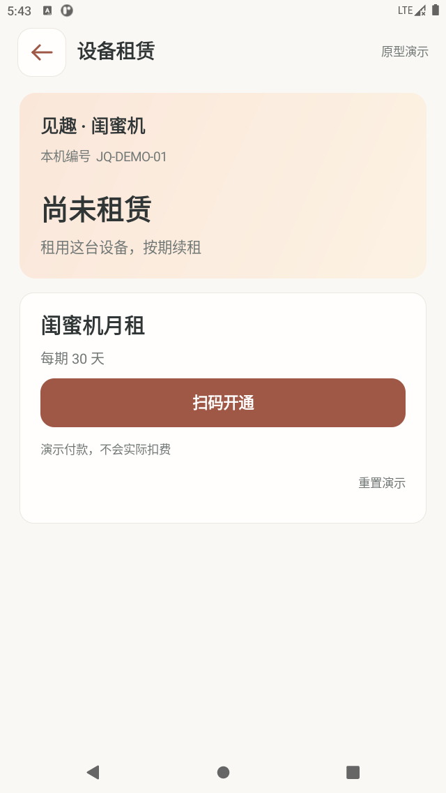
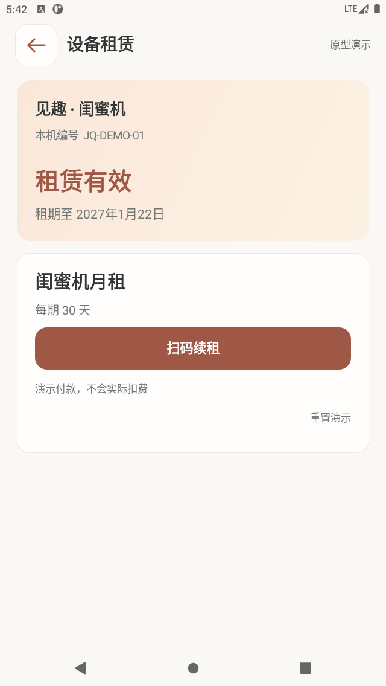
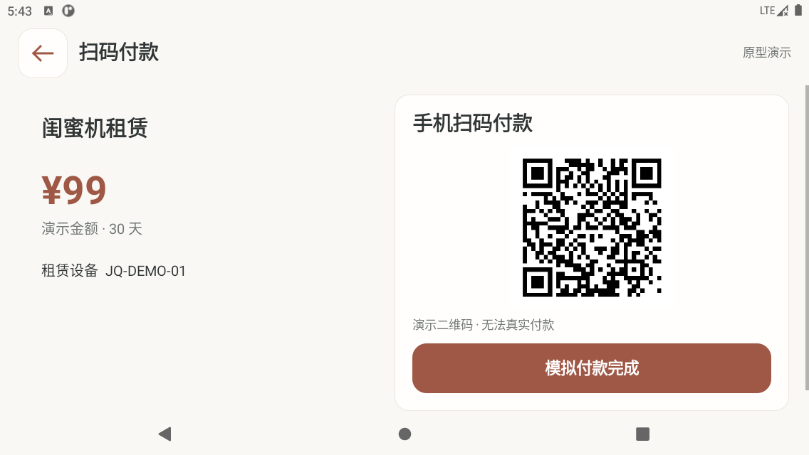

# JQ-003 后续迭代｜单机租赁订阅与二维码付款原型

> 2026-11-23；任务合同：[JQ-003 #3](https://github.com/sanchuang-dev/jianqu-senior-agent/issues/3) 中的 2026-11-23 最新补充；产品规则：[V0.2 PRD F-08](../product/PRD-v0.2.md)。本文仅保存测试证据，不替代合同。
>
> **这是演示原型，不接支付平台、不收款、不取得远程设备授权。**

## 本轮交付

- 当前设备 `JQ-DEMO-01` 独立租赁；移除旧版两个虚构服务套餐、给其他两台设备批量开通的界面和状态写入。
- 单一租期 30 天、样例金额 ¥99（均非已定商业规则）；扫码付款页面展示实际可见的二维码图像，**编码内容仅为不可付款的演示标识**。
- 唯一修改租期的动作是用户主动点击「模拟付款完成」；进入二维码页面或取消不修改状态。
- 首次演示开通：从本机当前时间延长 30 天；有效期内模拟续租：从原到期时间延长 30 天。到期判断取本机时间，本地 `SharedPreferences` 持久化。
- 状态为「尚未租赁」「租赁有效」「租赁已到期」及租期；重置入口为低视觉权重的演示辅助操作，重置前二次确认。
- Android HOME、全部应用、独立 SOS 和小暖本地脚本体验不因租赁状态受限；没有申请额外的支付权限或引入支付 SDK。

## Windows Android 11 模拟器验证（实际执行）

| 场景 | 结果 | 证据 / 限制 |
| --- | --- | --- |
| Windows JDK 17 + Android SDK 编译 `:app:assembleDebug :app:lintDebug` | **通过**（BUILD SUCCESSFUL，34 秒，44 tasks） | SDK XML / Gradle 10 / `onBackPressed` 仍有既有提示 |
| 安装本地 Debug APK | **通过**（`adb install` Success） | 同一 Windows debug 签名，不代表 GitHub Release APK 可覆盖升级 |
| HOME →「我的服务」→ 本机租赁 | **通过** | Android 11 模拟器真实手动点击和 UI 树 |
| 未租赁时小暖仍可进入本地模拟聊天 | **通过**（`CHAT_ACCESSIBLE_UNRENTED`） | 不因租赁状态阻断原有桌面服务 |
| 未租 → 打开二维码 → 系统返回，不改变租赁状态 | **通过**（`CANCEL_PASS`） | 未触发真实支付 |
| 点击「模拟付款完成」→ 显示租赁有效／扫码续租 | **通过**（`SIMULATED_PAYMENT_PASS`） | 仅本地演示状态 |
| 从 2026-12-23 到期续租至 2027-01-22，额外 30 天 | **通过**（`RENEWAL_VALID`，`RENEWAL_DATE`） | Android 11 模拟器当前日期为 2026-11-23 |
| 按 Home，重新进入后有效期仍在 | **通过**（`PERSISTED_REOPEN`） | 本地存储，不是服务端授权 |
| 重置确认 → 尚未租赁／扫码开通 | **通过**（`RESET_PASS`） | 仅清除本机 `rental_expiry_ms` |
| 旧多机开通、演示套餐 UI 不再出现 | **通过**（`NO_MULTI_DEVICE_UI_PASS`） | 本轮页面与源码检查 |
| 横/竖屏租赁与二维码页面 | **通过**（布局截图和相关 UI 树） | 已修复一处模拟器在改写分辨率后保持旧方向判断造成的挤压；使用实际显示宽高判断 |
| 真实扫码支付、支付回调、账单、机器回收、OEM 实机 | **未执行，不在本轮范围** | 二维码不可付款；商业租金/租期另议 |
| 调整系统时钟后「已到期」实机 UI 回归 | **未执行** | 代码已有按当前时间判断；真实时间可信源/反作弊另议 |

### 实际截图

| 未租赁 · 竖屏 | 模拟付款后有效 · 竖屏 |
| --- | --- |
|  |  |

| 二维码原型 · 竖屏 | 二维码原型 · 横屏 |
| --- | --- |
|  |  |

## 结论与边界

本轮验证的是**单机租赁状态 + 二维码付款交互原型**的本地闭环，不是实际收款、设备租赁合同、远程授权及真实设备验收。30 天、¥99 和 `JQ-DEMO-01` 都是可替换演示值。设备无订阅时基础 HOME 和本地原型仍可用，防止将原型权限当作真实锁机能力。
