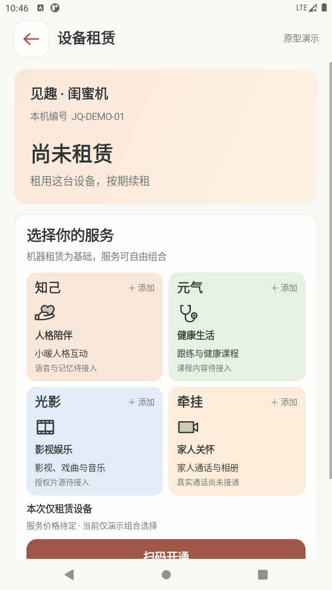
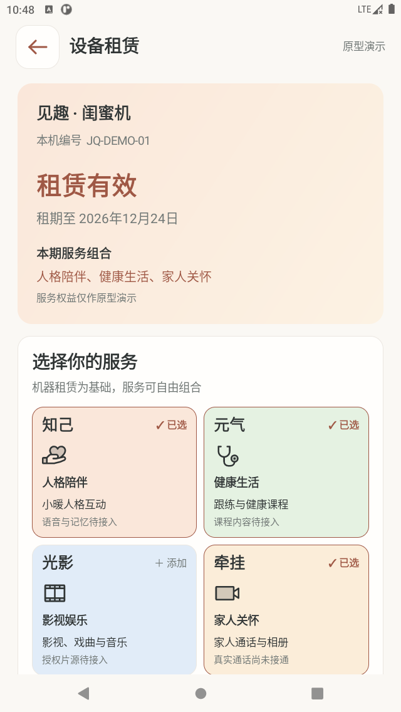
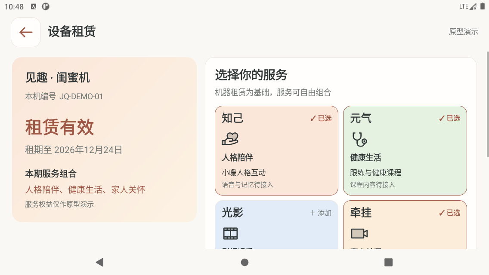

# JQ-003 后续｜单机租赁 × 四项服务组合原型验收

> 2026-11-24 · 本文记录当前代码与 Android 11 模拟器验证证据；产品唯一事实源为 [PRD V0.2 F-08](../product/PRD-v0.2.md)，任务合同仍由 [JQ-003 #3](https://github.com/sanchuang-dev/jianqu-senior-agent/issues/3) 持有。

## 产品边界

- **本机租赁仍为基础**，仅限 `JQ-DEMO-01`，没有其他设备、用户会员或机构账号入口。
- 四项可选服务：知己（人格陪伴）、元气（健康生活）、光影（影视娱乐）、牵挂（家人关怀）。这是**四项待定的体验方向原型**，可选 0–4 项，不是有偿套餐正式上架。
- 用户可以点击图标服务卡切换选择，页面立即更新组合摘要；「扫码开通／续租」进入核对页，展示已选服务。**服务无任何定价**；原来的 ¥99 / 30 天只是设备租金和期限的演示值，绝不称作服务组合总价。
- 扫码页沿用不可付款的 DEMO 二维码。只有点击「模拟付款完成」才同时将当前机器的模拟租期与模拟服务组合保存到本机 `SharedPreferences`。进入二维码页、返回、取消不修改已确认记录。已有有效租期沿原到期时间延长 30 天；其余从当前时间算起。
- 重置演示清除租期与服务组合。租赁过期或未开通时不宣称套餐有效；已保存的历史选择仅供继续作为草稿。
- 不接真实微信／支付宝支付、价格计算、后台、服务鉴权、设备锁或真实套餐能力；健康课程／授权影视／亲情通话／语音记忆均未由本原型上线。SOS、HOME、系统应用及小暖现有脚本体验均不被订阅拦截。

## 实际执行的验证

| 验证场景 | 结果 |
| --- | --- |
| Windows 本地 Gradle `:app:assembleDebug :app:lintDebug` | **通过**：BUILD SUCCESSFUL（37s）；保留既有 Android SDK XML / Gradle 与 `onBackPressed` 提示 |
| `adb install` 更新本地 Debug APK，Launcher 首页进入第 08 个「我的服务」 | **通过**；直接通过 adb 启动未导出的 DemoActivity 会被 Android 拒绝，这是正确的权限边界，改用 HOME 入口测试 |
| Android 11 竖屏四个服务卡、彩色背景、独立图标、选中状态 | **通过**；实际截图与 UI hierarchy |
| 任意多选：在实例中选择人格陪伴／健康生活／家人关怀，扫码核对页显示相同组合 | **通过**：`PAYMENT_ORDER_SELECTED_OK` |
| 扫码页 Android 返回／取消，不把草稿写成有效租赁 | **通过**：`CANCEL_NOT_ACTIVATED_OK` |
| 点击「模拟付款完成」后租赁有效，并显示对应本期服务组合 | **通过**：`COMMIT_PERSISTED_ON_DEMO_PAYMENT_PASS` |
| 离开页面返回 Launcher 后重新进入：租期与选中组合仍在 | **通过**：`PERSISTED_AFTER_REOPEN_PASS` |
| 已有三项组合，临时选中影视后进入续租页再取消，重新打开仍是原三项 | **通过**：`CANCEL_DRAFT_NOT_COMMITTED_PASS` |
| 通过二次确认「重置演示」清空租期与全部组合 | **通过**：`RESET_LEASE_AND_SERVICES_PASS` |
| Android 11 横屏双栏租赁与服务选择呈现 | **通过**：真实截图，支持在屏幕内滚动 |
| 真实支付／套餐价格／服务能力／OEM 实机／签名覆盖升级 | **未测试；不在本轮范围** |

## Android 11 模拟器真实截图

| 未租赁，可自由选择四项服务 | 演示扫码核对已选组合 |
| --- | --- |
|  |  |

| 模拟开通后服务组合状态 | 横屏双栏布局 |
| --- | --- |
|  |  |

结论：**仅证明本地交互原型可展示、可选择、可取消、可模拟确认并持久化。** 不代表四种服务已经真实可用，亦不代表设备租赁商业规则已确定。