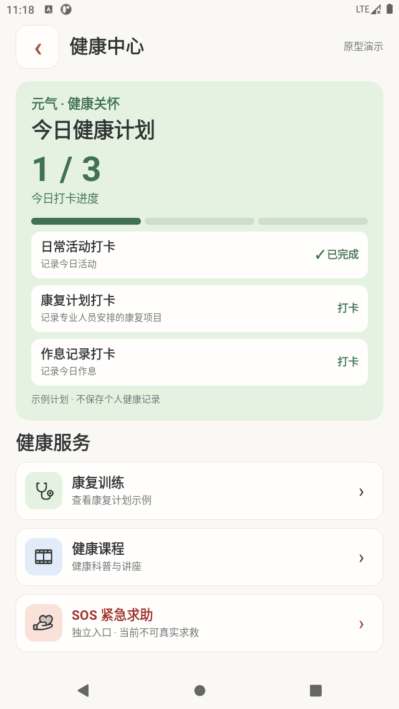
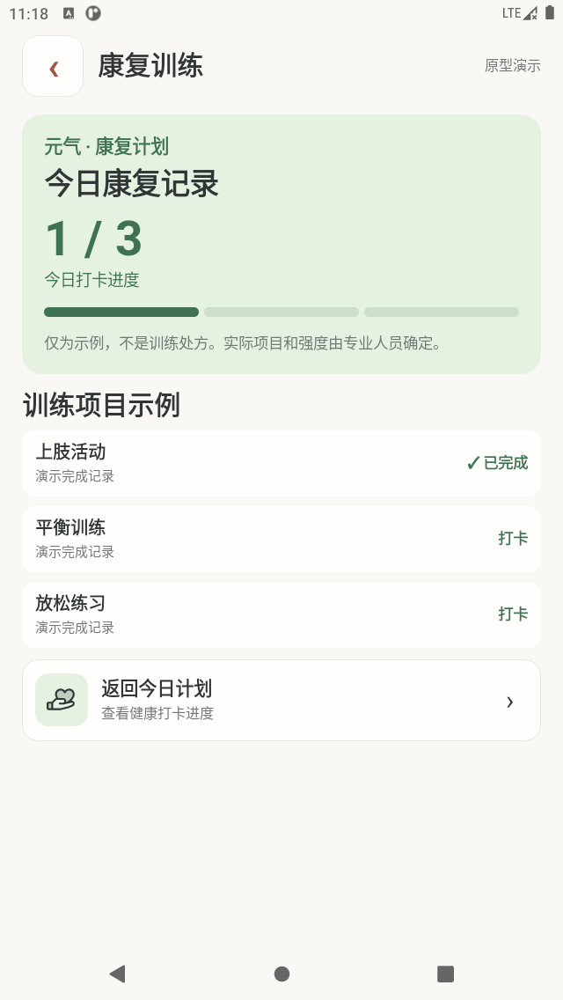
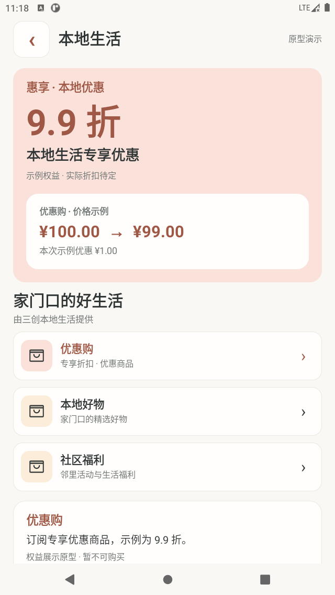
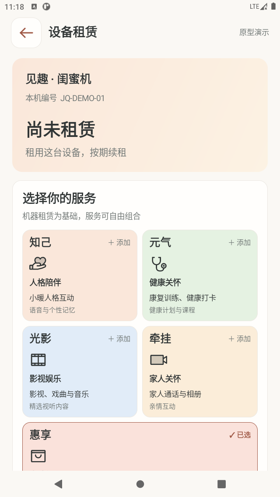
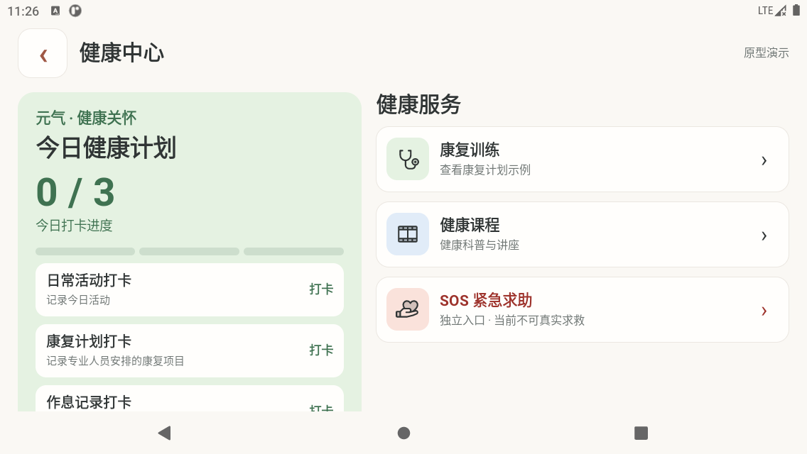
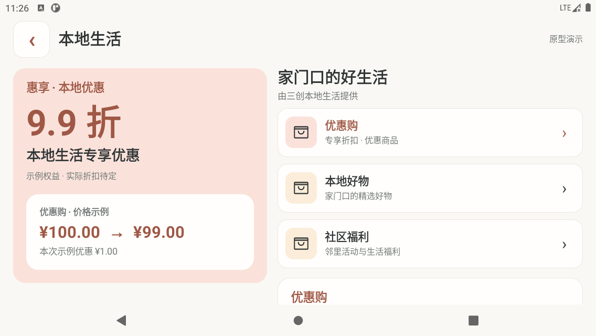
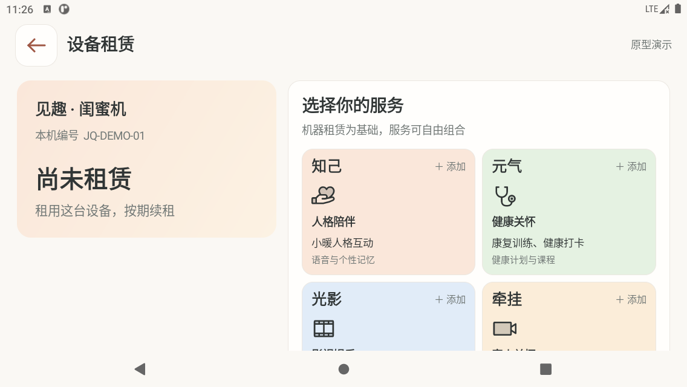

# 2026-11-24｜健康中心、本地生活与五项服务原型

依据 [JQ-003 #3 最新合同](https://github.com/sanchuang-dev/jianqu-senior-agent/issues/3) 和 [PRD V0.2](../product/PRD-v0.2.md)。本次仅 Android 本地演示，不接实际商城、优惠授权、支付、医疗服务或报警。

- Windows Android 11 模拟器竖屏实测 HOME → 健康中心 → 日常活动打卡，进度 0/3 → 1/3（CHECKIN_PASS）；康复独立页项目打卡（REHAB_PASS）；健康课程与独立 SOS 导航（COURSE_PASS、SOS_PASS）。
- HOME → 本地生活 → 9.9 折示例 → 本地好物选择及详情（LOCAL_PASS）；HOME → 我的服务 → 惠享选择 → 扫码核对本地优惠（FIVE_SERVICE_PASS）。最终脚本退出 0，ALL_UI_CHECKS_PASS。
- 横屏重新抓取稳定画面，双栏正常，纵向可滚动。未做完整横屏交互回归、OEM 真机验证或实际服务联调。
- 本地 assembleDebug + lintDebug 通过，安装成功。此轮健康记录仅在当前会话内，退出清除；SOS 不受订阅限制且无法实际发送求助。设备租金和折扣均为示例。

## 现场截图

| 健康中心 | 康复训练 |
| --- | --- |
|  |  |

| 本地生活 | 惠享选择 |
| --- | --- |
|  |  |

