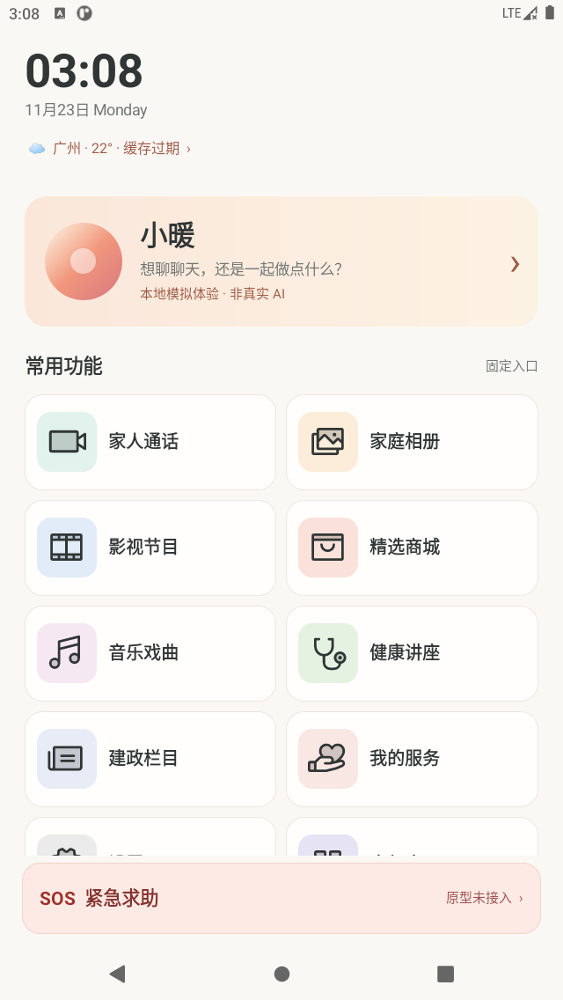
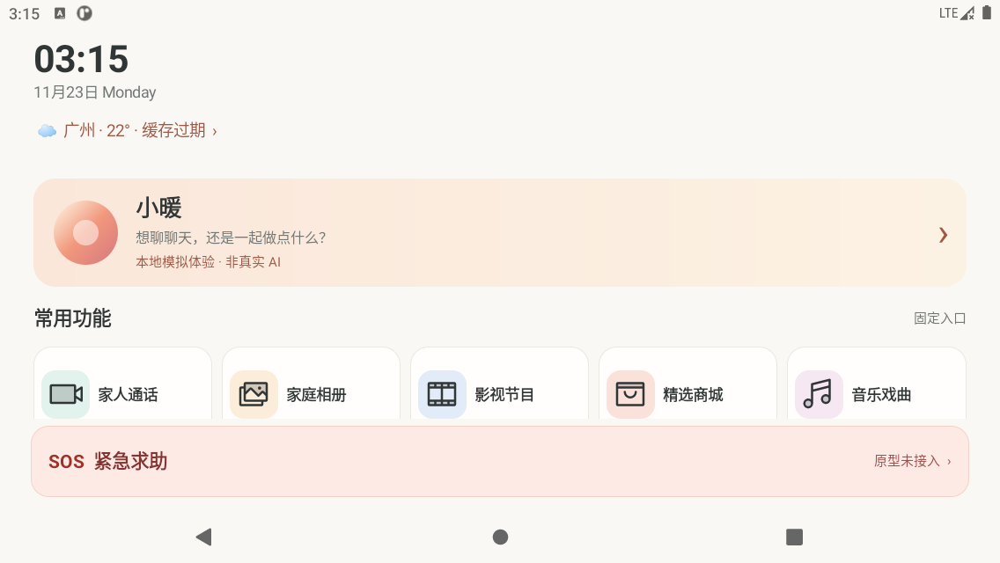

# 见趣 Launcher × 小暖｜V0.2 工程进度与验证快照

> 快照日期：**2026-11-23**（北京时间）
> 范围：`sanchuang-dev/jianqu-senior-agent`；Windows 工作机 `PC-20260104NIFC`、Android 11 模拟器、GitHub 发布与原型下载部署记录。
> **性质：工程事实与证据索引，不替代 [V0.1 PRD](../product/PRD-v0.1.md)、[V0.2 PRD](../product/PRD-v0.2.md)、各 Issue 验收合同或真实闺蜜机验收。**

## 一、阶段判断

**当前阶段：V0.2 可安装、可演示的 Android Launcher 预览原型；尚不是量产版或完成 OEM 真机验收的产品。**

- 已形成普通第三方 APK 的 Android HOME、真实已安装应用目录及启动链路；小暖、设备订阅与多项服务仍按各自约定提供本地模拟/未接入状态。
- V0.2 主屏、十个固定入口、独立 SOS、家人通话、内容与家庭相册、商城承接界面均已合入开发基线。固定入口 09「设置」、10「全部应用」；01–08 的最终产品定义仍以产品决策为准。
- 天气模块已有 **MET Norway 真实接口客户端、条款接受门槛和缓存/失败回退逻辑**；这不等于本轮完成真实接口联调。提供方条款须由负责人亲自阅读并接受，本报告不代为接受。
- 本轮 Windows 环境的 **138/138 项定向模拟交互检查通过**，另有 HOME → 系统应用 → Home 的实际操作证据；数字仅覆盖下面列出的测试，**不代表 V0.2 全部功能通过**。
- [阶段里程碑 JQ-001 #1](https://github.com/sanchuang-dev/jianqu-senior-agent/issues/1) 仍开放；其他 Issue 的 Open/Closed 与验收结论由各 Issue 自身维护，PR 合并不能自动视为收卡。

## 二、源代码、构建与发布位置

| 环节 | 已核对事实 | 证据 |
| --- | --- | --- |
| Windows 本地代码 | `dev` / `2e68c5081db52c6118dc53bcf23869a55348787f`；本次开始与结束工作区干净 | Windows 本地 `git status`、`git rev-parse` |
| GitHub 开发基线 | `dev` / `2e68c50` | [本轮 dev 提交](https://github.com/sanchuang-dev/jianqu-senior-agent/commit/2e68c5081db52c6118dc53bcf23869a55348787f) |
| 验证分支 | `test` / `d1ae3ee` | [晋级 PR #24](https://github.com/sanchuang-dev/jianqu-senior-agent/pull/24) |
| 发布源分支 | `prod` / `823012187e9922f3769b27d9053bf9940d0b0cb2` | [晋级 PR #25](https://github.com/sanchuang-dev/jianqu-senior-agent/pull/25) |
| 代码一致性 | 检查时 `dev...prod` 的文件差异为空；晋级有独立提交历史，**不要把 SHA 不同误判为源码不同** | [本轮固定提交比较](https://github.com/sanchuang-dev/jianqu-senior-agent/compare/2e68c5081db52c6118dc53bcf23869a55348787f...823012187e9922f3769b27d9053bf9940d0b0cb2) |
| 预发布版本 | `preview-jianqu-v0.2.0-8230121`；APK 内 `versionCode=2`、`versionName=0.2.0-preview` | [GitHub Release](https://github.com/sanchuang-dev/jianqu-senior-agent/releases/tag/preview-jianqu-v0.2.0-8230121) |
| GitHub 构建与预发布 | 2026-11-21 完成，相关 Actions 显示成功 | [prod APK 编译](https://github.com/sanchuang-dev/jianqu-senior-agent/actions/runs/44890760258) · [Release](https://github.com/sanchuang-dev/jianqu-senior-agent/actions/runs/44890804570) |
| 原型下载部署工作流 | 2026-11-21 `proto-infra` 的 Publish Jianqu prototype APK `workflow_dispatch` 成功 | [部署运行 #44891082237](https://github.com/sanchuang-dev/proto-infra/actions/runs/44891082237) |

**部署边界：** 原型下载发布流水线成功是部署证据；本轮**未重新执行外部下载站点 HTTP 端到端验收**，不能据此声称任何指定网站页面或真实设备已验证通过。

## 三、功能实现范围与本轮验收边界

| 工作项 | 当前代码或页面能力 | 2026-11-23 新增证据 / 仍缺什么 |
| --- | --- | --- |
| [JQ-002 #2](https://github.com/sanchuang-dev/jianqu-senior-agent/issues/2) / [PR #4](https://github.com/sanchuang-dev/jianqu-senior-agent/pull/4) | 普通 Android HOME、系统可见应用目录与真实启动 | Android 11 模拟器验证 HOME 解析、11 个可启动应用、真实打开 Settings 并按 Home 返回；未验证 OEM 与真实安装/卸载刷新 |
| [JQ-003 #3](https://github.com/sanchuang-dev/jianqu-senior-agent/issues/3) / [PR #5](https://github.com/sanchuang-dev/jianqu-senior-agent/pull/5) | 设备订阅、本地权益与小暖脚本模拟 | 已合入；本轮 **未重新执行**套餐持久化、重置及 12 组对话等完整回归 |
| [JQ-004 #7](https://github.com/sanchuang-dev/jianqu-senior-agent/issues/7) / [PR #15](https://github.com/sanchuang-dev/jianqu-senior-agent/pull/15) | 平衡型 HOME、十个固定入口、独立 SOS | 横/竖屏真实截图；640×1136 竖屏初始视窗需滚动才能完整看到 09/10，紧凑高度仍可优化 |
| [JQ-005 #8](https://github.com/sanchuang-dev/jianqu-senior-agent/issues/8) / [PR #16](https://github.com/sanchuang-dev/jianqu-senior-agent/pull/16) | 独立全部应用、搜索、设置、初次使用引导 | 真实目录和启动已验证；搜索、设置全量及首次引导未在本轮逐项重新回归 |
| [JQ-006 #9](https://github.com/sanchuang-dev/jianqu-senior-agent/issues/9) / [PR #17](https://github.com/sanchuang-dev/jianqu-senior-agent/pull/17) | 天气页面、城市选择、MET Norway 网络客户端与缓存/回退 | 构建通过；截图出现“缓存过期”；**本轮未证实真实 HTTP 获取、条款人工接受或断网缓存策略端到端行为** |
| [JQ-007 #10](https://github.com/sanchuang-dev/jianqu-senior-agent/issues/10) / [PR #18](https://github.com/sanchuang-dev/jianqu-senior-agent/pull/18) | 小暖直达与我的服务入口、视觉统一 | 已合入；小暖完整交互本轮未重测 |
| [JQ-008 #11](https://github.com/sanchuang-dev/jianqu-senior-agent/issues/11) / [PR #19](https://github.com/sanchuang-dev/jianqu-senior-agent/pull/19) | 家人通话的联系人与视频状态演示（非真实视频） | **21/21** 本地 UI 检查通过 |
| [JQ-009 #12](https://github.com/sanchuang-dev/jianqu-senior-agent/issues/12) / [PR #20](https://github.com/sanchuang-dev/jianqu-senior-agent/pull/20) | 内容栏目共用列表/详情/播放界面；家庭相册模拟 | **52/52** 本地 UI 检查通过；未接真实内容服务及私人相册 |
| [JQ-010 #13](https://github.com/sanchuang-dev/jianqu-senior-agent/issues/13) / [PR #21](https://github.com/sanchuang-dev/jianqu-senior-agent/pull/21) | 精选商城入口、未登录/离线/未就绪/不可用回退 | **20/20** 本地 UI 检查通过；无真实订单或支付 |
| [JQ-011 #14](https://github.com/sanchuang-dev/jianqu-senior-agent/issues/14) / [PR #22](https://github.com/sanchuang-dev/jianqu-senior-agent/pull/22) | SOS 二次确认、取消、模拟处理中和多种失败状态 | **45/45** 本地 UI/权限/外部动作检查通过；**绝无真实报警、拨号或通知送达** |

## 四、Windows / Android 11 验证记录

- **工作机**：`PC-20260104NIFC`；工程 `E:\Jianqu-Android-Test\repo\jianqu-senior-agent`。
- **模拟器**：`jianqu-win-light`，Android 11 / x86_64、2 CPU、2 GiB RAM；验证了 640×1136 竖屏与 1136×640 横屏。**不是参考硬件 4 GiB RAM 或 21.5–32 英寸的 OEM 闺蜜机。**
- **本地构建**：执行 `E:\Jianqu-Android-Test\build-jianqu.cmd`（`:app:assembleDebug :app:lintDebug`），结果 **BUILD SUCCESSFUL in 33s**；44 tasks，15 executed / 29 up-to-date。存在 Kotlin `kotlinOptions`、旧 `targetSdk=33`、Gradle 10 兼容性及 Android SDK XML 工具版本提醒；本轮没有把警告计为测试失败，也未消除这些警告。
- **安装与启动**：`install-jianqu.cmd` 显示 `Success`，`LauncherActivity` 成为前台 Activity；`dumpsys package` 显示 `versionCode=2` / `0.2.0-preview`。
- **138 项定向检查**：Windows 本地 `jq008-smoke.ps1`（21）、`jq009-smoke.ps1`（52）、`jq010-smoke.ps1`（20）、`jq011-smoke.ps1`（45），四组均以各自 `*_SMOKE_PASS` 与退出码 0 结束。覆盖模拟通话、内容/相册演示、商城失败回退、SOS 的取消/失败/页面返回/方向切换及敏感权限断言。**这些脚本位于工作机测试目录，并非本仓库或 CI 的可移植测试套件。**
- **HOME 真实行为抽测**：系统 `resolve-activity` 命中 `cn.sanchuang.jianqu/.LauncherActivity`；“全部应用”列出模拟器中 11 个系统可启动 App；点 Settings 打开 `com.android.settings/.Settings`；按 Home 回到 `LauncherActivity`。首次手工坐标误点已通过读取 UI 节点边界并滚动重测排除；不计作产品故障。
- **未执行**：真实供应商硬件、完整安装/卸载刷新、跨重启默认桌面、长期稳定性、真实视频呼叫、联网订阅/交易、真实 SOS 送达，以及发布 APK 在目标机上的升级路径。

### 本轮真实屏幕截图

以下为 Windows Android 11 模拟器采集，不是设计稿或供应商产品渲染。竖屏初始视窗的 09/10 入口可能被下方区域遮挡，需要滚动查看。

| 竖屏 640×1136 | 横屏 1136×640 |
| --- | --- |
|  |  |

## 五、APK 完整性与升级风险

| APK | SHA-256 | 签名证书 SHA-256 |
| --- | --- | --- |
| Windows 本地 `dev` Debug 构建（本轮用于模拟器回归） | `46326bd9e8482377c3569c0c4688f2bc5fad1964782a5921ee73ba9232b3ed7b` | `ceb91c69c2485d46977309f2d87567d0e907e82c6fb5b9ca447fdddef05ee2b6` |
| GitHub V0.2.0 预发布 `jianqu-demo.apk`（2,677,859 bytes） | `ef2eafc819e2280947e33f5a78a42c7967a9e7aefce497f20a8ba42dbb8f8da4` | `9eea9c377d504c2bcb5ec8f9c1177fab6417cd8ea77a38a930c3468d7fa107c8` |

- GitHub 预发布 APK 已下载至 `E:\Jianqu-Android-Test\downloads\jianqu-v0.2.0-prod-8230121.apk`，大小与 SHA-256 **均与 Release 资产声明一致**。
- 两个 APK 的源码基线对应同内容，但 **Debug 签名证书不同**。因此**不能保证在同一设备上直接互相覆盖升级**；正式交付前需设计稳定签名、升级与数据保留策略并实测。此次未为测试发布包而卸载已有模拟器应用，以免清空数据。
- 本轮 138 项通过的主体是 **Windows 本地重编译的 dev APK**，不是直接运行 GitHub Release APK；不可用相同版本名偷换产物验证结论。

## 六、未闭环与建议优先级

1. **P0｜真机验收（JQ-001）**：取得实机型号、ROM、分辨率/密度、竖横屏与触控证据；验证普通安装、默认 HOME、重启后 HOME、应用安装/卸载刷新、真实应用跳转与返回、持续运行。无设备则保持未验。
2. **P0｜发布签名与升级**：明确固定签名方案及测试/正式包边界，用至少两版 APK 验证覆盖升级与模拟数据保留；不要默认 Debug APK 可作为可持续升级产品。
3. **P1｜HOME 紧凑高度**：以目标真机为首要依据优化 09/10 固定入口可见性与 SOS 可发现性；当前 640×1136 竖屏仍需要滚动，不能将其误记为“一屏完整显示”。
4. **P1｜天气真实联调**：负责人先阅读并决定是否接受 MET Norway 条款，再记录真实设备 HTTP、缓存到期、304、断网、城市切换与过期提示证据。未经确认不能由程序/测试代理擅自接受条款。
5. **P1｜回归可复现性**：将 Windows 机外部脚本整理成仓库内可复用测试或明确测试手册；按范围补测 JQ-003／005／006／007。服务模拟检查不替代真实 API 验收。
6. **产品决策保留**：家人通话的真实服务、SOS 接收/回执责任、家庭相册数据源、内容版权与商城承接、公共/个人使用模式等，均不因 V0.2 预览可点击而视为已批准上线。

## 七、证据与使用说明

- [V0.1 PRD](../product/PRD-v0.1.md)、[V0.2 PRD](../product/PRD-v0.2.md)：产品需求及待决策项；[JQ-001](https://github.com/sanchuang-dev/jianqu-senior-agent/issues/1) 与各子 Issue：具体工作项验收合同。
- [JQ-002 既有验证](JQ-002.md)、[JQ-003 既有验证](JQ-003.md)：2026-11-19 的历史验证记录；不得将其中未测项倒填为本轮通过。
- [Release V0.2.0](https://github.com/sanchuang-dev/jianqu-senior-agent/releases/tag/preview-jianqu-v0.2.0-8230121)、[原型发布工作流](https://github.com/sanchuang-dev/proto-infra/actions/runs/44891082237)：公开可查的构建/发布证据。
- Windows 本地复核入口：`E:\Jianqu-Android-Test\WORKSTATION.txt`、`build-jianqu.cmd`、`install-jianqu.cmd`、`jq008-smoke.ps1` 至 `jq011-smoke.ps1`，原始截图在 `screenshots\`。**它们不随仓库克隆分发**；本报告只写确实执行过的结果，不凭文字生成新通过记录。

> **结论：** V0.2 的演示与 Android 11 模拟器主链路已有较强证据，可用于内部展示和下一轮产品评审；继续保留“预览原型”定位。进入可靠设备产品或真实服务上线前，必须补签名升级、OEM 实机、天气条款与外部能力端到端验收。
